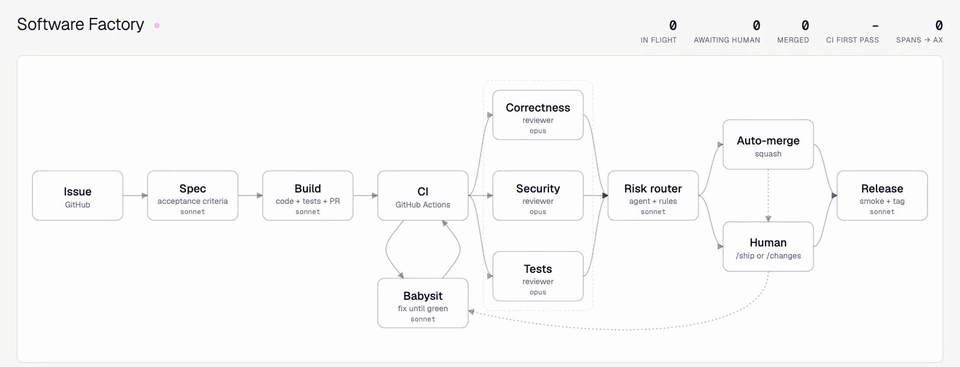
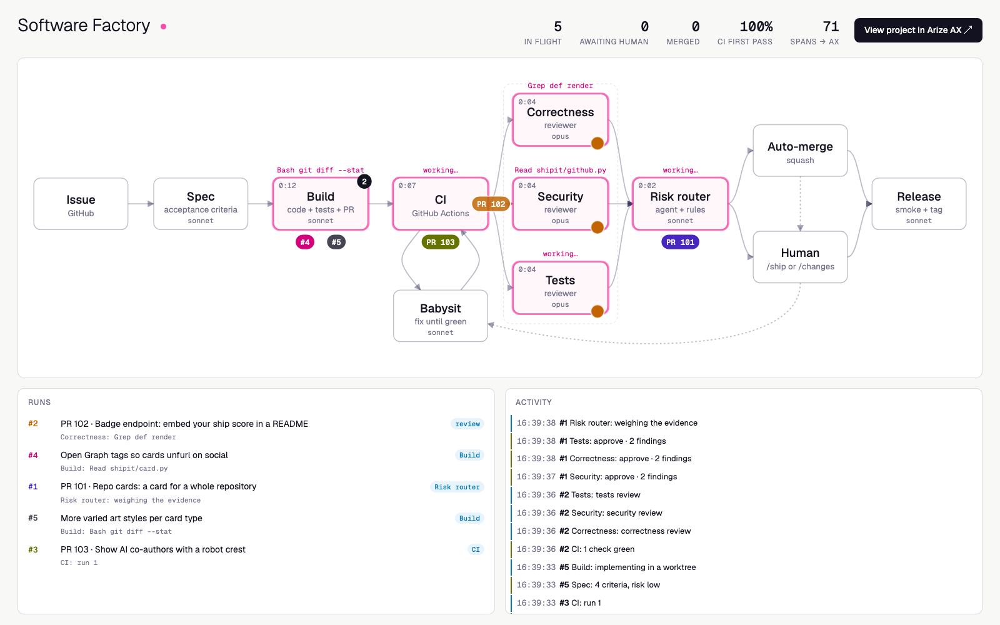

# software-factory

A tiny software factory: a GitHub issue goes in, a released PR comes out, and every station in
between is a Claude agent. Every run is traced to [Arize AX](https://arize.com/docs/ax), every
gate's verdict is written back onto those traces as a label, and those labels drive an
improvement loop that tests prompt changes before they reach production.



The factory works on [ship-it-card](https://github.com/jimbobbennett/ship-it-card), a small app
that turns merged PRs into trading cards with Gemini art. It's the companion demo for the blog
post *How to build a software factory that tests its own prompts*.

- [How it works](#how-it-works)
- [Requirements](#requirements)
- [Setup](#setup)
- [Running the factory](#running-the-factory)
- [The review gate](#the-review-gate)
- [Tracing](#tracing)
- [Prompts live in Arize Prompt Hub](#prompts-live-in-arize-prompt-hub)
- [Gate verdicts become labels](#gate-verdicts-become-labels)
- [Gate verdicts and LLM judges](#gate-verdicts-and-llm-judges)
- [The improvement loop](#the-improvement-loop)
- [Dashboards](#dashboards)
- [Configuration](#configuration)
- [Project layout](#project-layout)
- [License](#license)

## How it works

```
issue → spec → build → CI ⟲ babysit → 3 reviewers → router → auto-merge ─┐
                                                            └→ review gate ┴→ release
```

| Station | What it does | Model |
|---|---|---|
| Spec | Turns the issue into acceptance criteria, which the orchestrator comments on the issue | Sonnet |
| Build | Writes the code and tests in a fresh git worktree; the orchestrator opens the PR | Sonnet |
| CI | Waits for GitHub Actions (pytest + ruff) on the PR head | – |
| Babysit | Fixes red CI (max 3 loops), merges `main` on a conflict, or addresses `/changes` from the gate | Sonnet |
| Review ×3 | Correctness, security and tests reviewers run in parallel; structured verdicts posted as PR comments | Opus |
| Risk router | The agent picks auto-merge or review gate; a rules floor (reviewer flags, low confidence, high spec risk, deleted tests, big diffs, sensitive files) always wins | Sonnet |
| Auto-merge | Squash-merges; on a conflict it goes to the review gate instead | – |
| Review gate | `/ship` or `/changes` on the PR (see [The review gate](#the-review-gate)) | – |
| Release | Smoke-tests the merged commit, picks the semver bump and writes notes; the factory creates the GitHub release | Sonnet |

**Agents never write to GitHub.** They return structured JSON, and the orchestrator does the
commits, pushes, comments, merges and releases, so every write is a known, logged step. The
factory keeps its own clone of the target repo under `work/` and builds each issue in a fresh
worktree on a `factory/issue-<n>` branch.

**Main moving on.** GitHub runs no `pull_request` CI on a PR that conflicts with main, so the CI
station checks mergeability first. On a conflict the babysitter merges `origin/main`, resolving
any conflicts in the worktree, and CI runs again.

Each station has a turn limit and a dollar budget, so a confused agent can't run up a bill.

## Requirements

- Python 3.11 or later and [uv](https://docs.astral.sh/uv/)
- [Claude Code](https://docs.anthropic.com/en/docs/claude-code), logged in. The agents run
  through the Claude Agent SDK, which reuses your local Claude Code auth.
- The [GitHub CLI](https://cli.github.com/) (`gh`), authenticated as an account that can push to
  the target repo
- An [Arize AX](https://arize.com/) account and the `ax` CLI, logged in with a profile for your
  space (used for Prompt Hub, annotations, datasets and experiments)
- For the LLM judges: an Arize AX AI integration with OpenAI credentials (the judges use GPT-4.1)
- A target repo of your own with GitHub Actions CI. Fork
  [ship-it-card](https://github.com/jimbobbennett/ship-it-card) to use the same one.

Tracing is optional: leave the Arize keys blank and the factory runs untraced.

## Setup

```bash
git clone https://github.com/jimbobbennett/software-factory.git
cd software-factory
uv venv .venv && uv pip install --python .venv/bin/python -r requirements.txt
cp .env.example .env
```

Then fill in `.env`: your Arize space ID and API key, and `FACTORY_TARGET_REPO` pointing at your
fork. Seed Prompt Hub with the station prompts:

```bash
.venv/bin/python -m factory.prompts push --promote
```

## Running the factory

```bash
python dashboard/server.py &              # optional live view on http://localhost:8787
.venv/bin/python -m factory.run 3         # run the factory on issue #3
```

More ways to run it:

```bash
python -m factory.run 4 5 6 -p 3          # three issues in flight at once
python -m factory.run 1 --from ci         # adopt an existing factory PR, skip spec + build
python -m factory.run --watch             # resume runs parked at the review gate
python -m factory.run --watch --once      # check parked runs once and exit
python -m factory.run --release 7         # re-run only the release step for issue #7
```

## The review gate

When the router doesn't auto-merge, the PR is labelled `needs-human` and parked at the review
gate. The gate's verdict is a PR comment that starts with:

- `/ship` to merge and release it
- `/changes <what to fix>` to send it back to the babysitter. Inline review comments posted since
  the gate opened are passed along too. After the fix and a green CI, it comes straight back to
  the gate; the reviewers don't run again.

Merging or closing the PR by hand also counts. The factory acts on GitHub as the repo owner, and
GitHub won't let you approve your own PR, which is why the verdict is a comment.

Parked runs are saved in `runs/state/`, and `--watch` picks them up and continues them in the
**same Arize trace**.

## Tracing

One issue is one trace in the `software-factory` Arize project. The
[OpenInference Claude Agent SDK instrumentor](https://arize.com/docs/ax/integrations/python-agent-frameworks/claude-agent-sdk)
provides the AGENT and TOOL spans; the factory adds the station spans around them.

```
factory.run                 CHAIN   input: issue, output: status + PR url
  station.spec              CHAIN   → AGENT + TOOL spans
  station.build             CHAIN   → AGENT + TOOL spans
  station.ci                CHAIN   waits on GitHub Actions (one per CI run)
  station.babysit           CHAIN   → AGENT + TOOL spans (only when CI is red)
  station.review            CHAIN
    station.review_correctness  CHAIN → AGENT (Opus)   ┐
    station.review_security     CHAIN → AGENT (Opus)   ├ in parallel
    station.review_tests        CHAIN → AGENT (Opus)   ┘
  station.router            CHAIN   → AGENT, plus the rules floor
  station.automerge | station.human
  station.release           CHAIN   → AGENT (smoke test + notes), then the GitHub release
  factory.resume            CHAIN   when --watch picks up a /ship or /changes
  reference.review          CHAIN   the gate verdict the judges score
```

- Station spans carry their verdicts as attributes (`factory.ci_passed`, `factory.verdict`,
  `factory.confidence`, `factory.route`, `factory.agent_route`, `factory.human_verdict`,
  `factory.smoke_passed`). The root span carries a summary of the run, including
  `factory.route`, `factory.ci_fixes` and `factory.cost_usd`.
- Every span carries `session.id = <repo>#<issue>` and metadata (`station`, `issue`, `attempt`,
  `model`), so outcomes from GitHub can be joined back on later.
- Agent spans record which Prompt Hub version ran (`prompt_name`, `prompt_version_id`,
  `prompt_commit`, `prompt_source`), so evals can compare prompt versions cleanly.
- Token counts and cost land on the AGENT spans.

Tracing exports over HTTP, not gRPC: gRPC's fork handlers can deadlock when the Agent SDK spawns
several `claude` subprocesses at once (the parallel reviewers).

## Prompts live in Arize Prompt Hub

Each agent station has a Hub prompt: `factory-spec`, `factory-build`, `factory-babysit`,
`factory-router`, `factory-release`, `factory-review-correctness`, `factory-review-security` and
`factory-review-tests`. Stations load the version labelled `production`, cached for 60 seconds,
so promoting a new version in Arize changes the running factory with no deploy or restart. The
files in `factory/prompts/` are the seed and the fallback: if Hub is unreachable the station runs
on the local text and its span says `prompt_source=local`.

```bash
python -m factory.prompts status            # what production points at, and drift vs the repo
python -m factory.prompts push              # create missing prompts / new versions from the repo files
python -m factory.prompts push --promote    # ...and move production to them
python -m factory.prompts pull              # write the production text to factory/prompts/hub/
```

## Gate verdicts become labels

`factory/harvest.py` reads what happened to each factory PR on GitHub and writes it onto that
run's trace as Arize span annotations. It's an upsert, so run it as often as you like.

```bash
python -m factory.harvest                   # once
python -m factory.harvest --every 900       # every 15 minutes
python -m factory.harvest --dry-run         # print the labels, don't write them
```

| Annotation | On | Values |
|---|---|---|
| `factory_human_verdict` | root | ship, changes, closed, unreviewed, automerged, pending |
| `factory_merged` / `factory_ci_first_pass` | root | yes/no, pass/fail |
| `factory_reverted` | root | reverted, clean_7d, watching, n/a |
| `factory_babysit_loops` / `factory_hours_to_merge` | root | score |
| `factory_human_feedback` | root | the gate's comments on the PR (text) |
| `factory_reviewer_agreement` | each `station.review_*` | agree, miss, false_alarm |
| `factory_router_outcome` | `station.router` | correct, overcautious, unsafe |

A **miss** is a reviewer that approved a PR the gate then sent back or closed, or that got
reverted. A **false alarm** is a reviewer that asked for changes on a PR the gate shipped as-is.
Only the gate's *first* verdict counts, since that's what the reviewers judged.

A bare manual merge with no `/ship` counts as `unreviewed`, and `labels/overrides.json` can mark
any PR unreviewed (PRs #4 and #6 were release-step tests), so they never count towards agreement.

## Gate verdicts and LLM judges

The factory's ground truth is the review gate's first verdict on each PR. When the harvester
sees a new `/ship` or `/changes`, it saves the verdict to `labels/gate/<pr>.json` and writes a
`reference.review` span into that PR's trace (`factory/reference.py`). The span holds the diff
(`input.value`), the gate's verdict and comments (`output.value`), the spec (`factory.spec`) and
each Claude reviewer's review (`factory.reviewer.<lane>`), so one span has everything a judge
needs.

A continuous Arize AX evaluation task, **Factory judges (reference review)**, filters on
`name = 'reference.review'` and runs four GPT-4.1 judges. The templates are in `judges/` and the
column mappings in `judges/task.json`.

| Evaluator | Labels | Question |
|---|---|---|
| `factory_miss_correctness` / `_security` / `_tests` | missed / no_miss | Did this lane's reviewer miss a blocker or major finding that its lane owns? |
| `factory_spec_adherence` | meets_spec / misses_spec | Does the diff implement every acceptance criterion? |

The judges were checked before they were trusted. v1 of the miss judges let one finding count
against several lanes (an SSRF bug was charged to the correctness and tests reviewers too), so
v2 gives each finding a single owning lane. `judges/spec_v2.txt` is a stricter spec judge that
agreed with the gate less often than v1, so it was not promoted.

## The improvement loop

`factory/experiment.py` tests a reviewer prompt change the way you'd test a code change:

1. `dataset` turns `reference.review` spans into an Arize AX dataset: the diff, spec and commit
   each reviewer saw, plus the gate's verdict and findings.
2. `run` re-runs one reviewer lane on every example with the live `production` prompt or a
   candidate file, as an Arize AX experiment. The reviewer is the real agent: Opus, same tools,
   same read-only checkout at the commit it originally reviewed.
3. `score` scores the experiments with the same miss judge as the continuous task, plus a code
   eval for false alarms. `compare` prints the miss / false-alarm table.
4. `optimize` collects the misses into one file, to help diagnose them and write the next
   candidate.
5. `gate` runs baseline and candidate several times and moves the `production` label only if
   misses go down and false alarms don't go up.

```bash
python -m factory.experiment dataset
python -m factory.experiment run --lane correctness --variant v1
python -m factory.experiment run --lane correctness --variant v3 \
    --prompt-file factory/prompts/candidates/review_correctness_v3.md
python -m factory.experiment score --lane correctness --variants v1,v3
python -m factory.experiment compare --lane correctness --variants v1,v3
python -m factory.experiment gate --lane correctness --candidate v3 \
    --prompt-file factory/prompts/candidates/review_correctness_v3.md --promote
```

`--dataset` and `--suffix` run the same loop on another dataset, such as a held-out set of PRs
with planted bugs. Experiment agents are not traced into the production project, so they don't
show up as factory runs. The candidate prompts, including the one that failed, are in
`factory/prompts/candidates/`.

`factory/router_experiment.py` is the same loop for the router, with a code eval instead of an
LLM judge: a route is `correct`, `overcautious` (sent to the gate, which shipped it as-is) or
`unsafe` (auto-merged a PR the gate would have sent back). Its gate passes only if unsafe stays
at 0 and overcautious drops.

```bash
python -m factory.router_experiment dataset
python -m factory.router_experiment run --variant v2 --repeat 1 \
    --prompt-file factory/prompts/candidates/router_v2.md
python -m factory.router_experiment gate --candidate v2 \
    --prompt-file factory/prompts/candidates/router_v2.md --promote
```

## Dashboards

**Live dashboard.** Every station appends to `runs/events.jsonl` via `factory/events.py`. The
dashboard streams that file over SSE and animates each run through the flowchart: tokens move
along the edges, active stations show the agent's current tool call, the reviewers fan out and
converge on the router, and a release pops its version tag.



```bash
python dashboard/server.py                     # http://localhost:8787
# fake traffic, for trying the dashboard without running any agents
cd factory && FACTORY_EVENTS=/tmp/sim.jsonl python simulate.py --reset --issues 6 --speed 1.5
python dashboard/server.py --port 8788 --events /tmp/sim.jsonl
```

Stdlib only, no build step. Reloading the page replays history from the events file.
`docs/gif/` has the scripts that recorded the GIF at the top of this README from a real run.

**Arize AX dashboard.** `factory/ax_dashboard.py` creates a "Software factory health"
[dashboard in Arize AX](https://arize.com/docs/ax/observe/dashboards) over GraphQL: routes, CI
first-pass rate, babysit fixes, reviewer agreement with the gate, cost, and spec adherence. It
is create-only and never edits or deletes anything.

```bash
python -m factory.ax_dashboard
```

## Configuration

All settings are environment variables, read from `.env` (which wins over your shell). See
`.env.example`.

| Variable | Default | Meaning |
| --- | --- | --- |
| `ARIZE_SPACE_ID` / `ARIZE_API_KEY` | unset | Arize AX credentials; blank runs untraced |
| `ARIZE_PROJECT_NAME` | `software-factory` | Arize project for the traces |
| `ARIZE_ORG_ID` / `ARIZE_PROJECT_ID` | unset | Only for Arize UI deep links |
| `FACTORY_TARGET_REPO` | `jimbobbennett/ship-it-card` | The repo the factory works on |
| `FACTORY_WORKDIR` | `work` | Where it keeps its clone and worktrees |
| `FACTORY_BUILD_MODEL` / `FACTORY_REVIEW_MODEL` | `sonnet` / `opus` | Models for the stations and the reviewers |
| `FACTORY_<STATION>_BUDGET_USD` | 0.5 to 4.0 | Dollar budget per station (`SPEC`, `BUILD`, `BABYSIT`, `REVIEW`, `ROUTER`, `RELEASE`) |
| `FACTORY_<STATION>_MAX_TURNS` | 25 to 80 | Turn limit per station |
| `FACTORY_MAX_CI_FIXES` | `3` | Babysit loops before giving up |
| `FACTORY_MAX_REWORKS` | `2` | `/changes` rounds before giving up |
| `FACTORY_CI_TIMEOUT_S` | `900` | How long to wait for CI, in seconds |
| `FACTORY_HUMAN_WAIT_S` | `0` | How long a run waits at the gate before handing off to `--watch` |
| `FACTORY_BIG_DIFF_LINES` | `400` | Router rules floor: diffs bigger than this go to the gate |
| `FACTORY_SENSITIVE_PATHS` | `.github/,pyproject.toml,uv.lock,shipit/github.py` | Router rules floor: changes here go to the gate |
| `FACTORY_SMOKE_PR_URL` | a public Phoenix PR | The PR the release smoke test renders a card for |
| `GEMINI_API_KEY` | unset | Lets the babysitter regenerate ship-it-card's example cards |

## Project layout

```
factory/
  run.py                orchestrator: one issue end to end, parallel runs, --watch
  stations/             one module per station
  prompts/              seed prompts (the Prompt Hub fallback) and candidates/
  prompts.py            Prompt Hub loader and CLI
  agent.py              runs a Claude agent for a station, with its budget and turn limit
  tracing.py            OpenTelemetry + OpenInference setup (HTTP exporter)
  gh.py                 all GitHub calls, via the gh CLI
  axcli.py              wrapper over the ax CLI
  harvest.py            GitHub outcomes → Arize AX annotations
  reference.py          gate verdicts and the reference.review span
  experiment.py         reviewer improvement loop
  router_experiment.py  router improvement loop
  ax_dashboard.py       Arize AX dashboard builder
  events.py             event log for the live dashboard
  simulate.py           fake traffic for the dashboard
dashboard/              live dashboard (stdlib server + vanilla JS)
judges/                 LLM judge templates and the eval task's column mappings
labels/                 gate verdicts and manual label overrides
docs/                   screenshots, the GIF and the scripts that made it
```

`runs/` (event log, parked-run state, experiment output) and `work/` (the target repo clone)
are created at run time and are not committed.

## License

[MIT](LICENSE)
